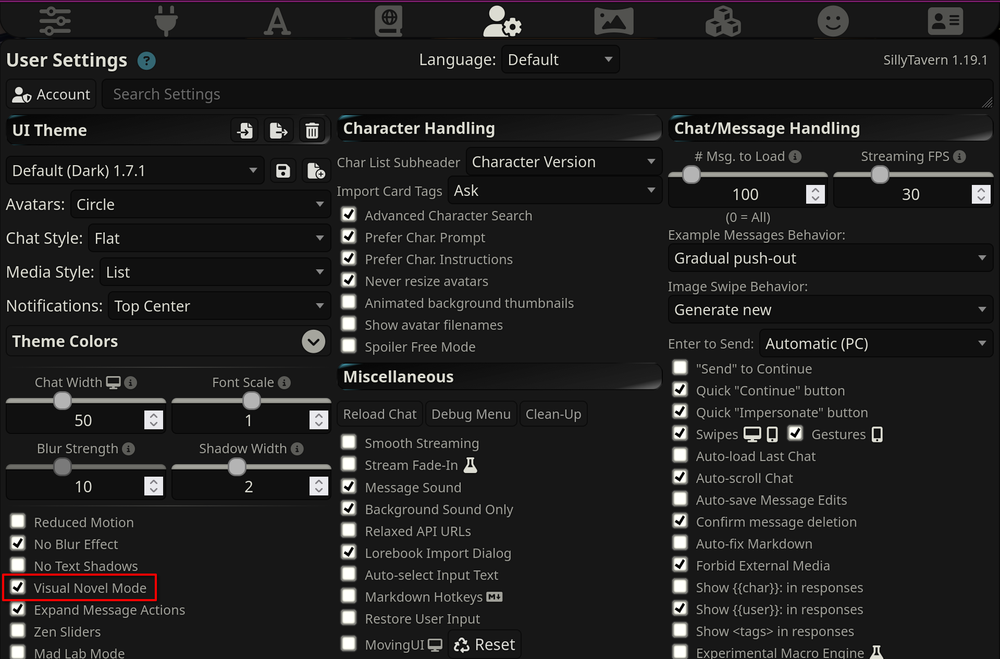
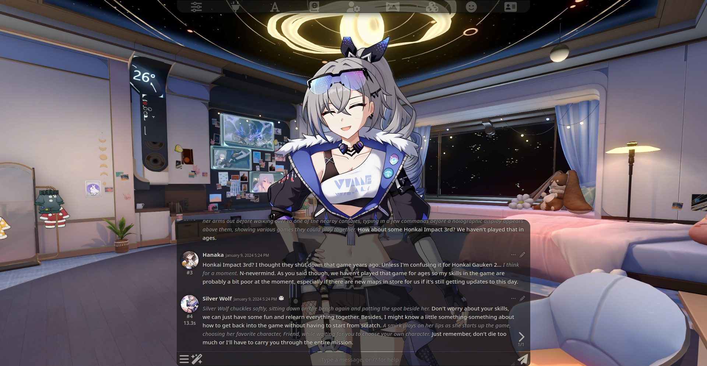
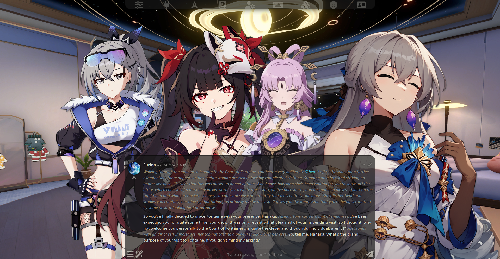
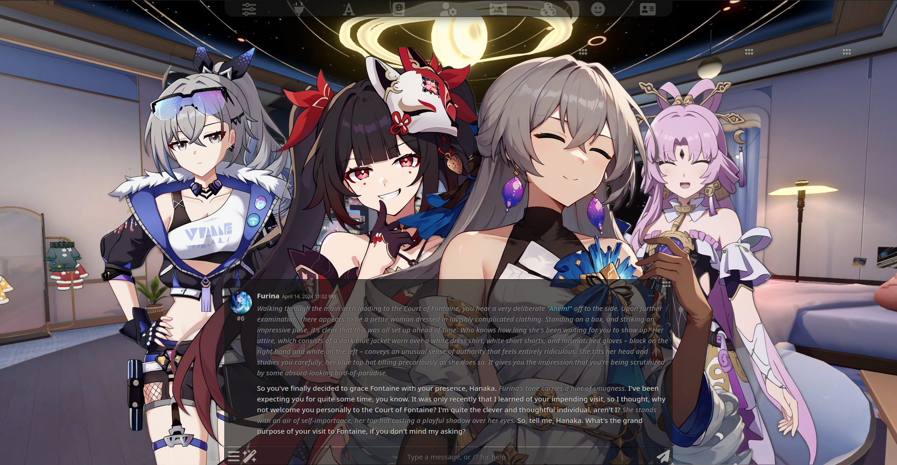
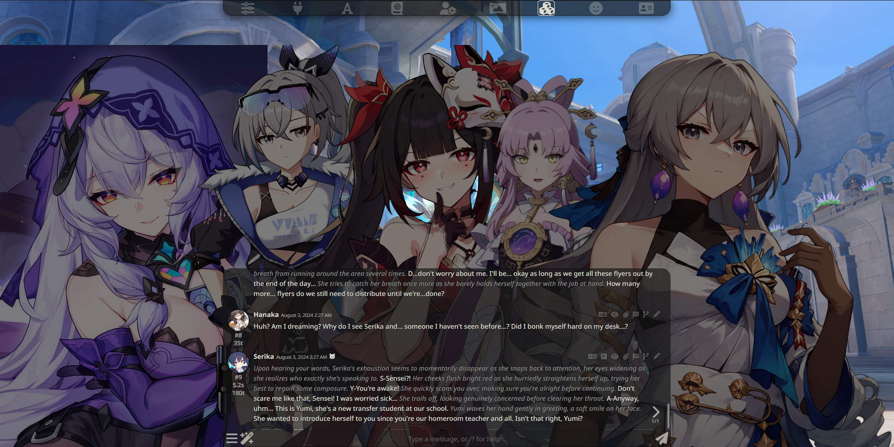
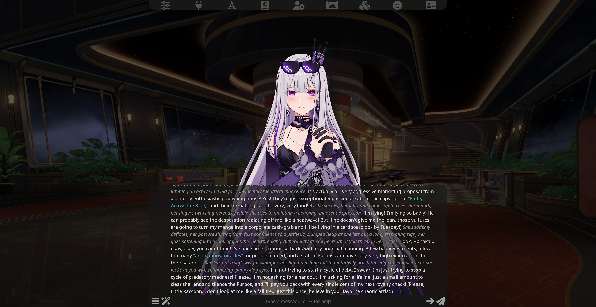
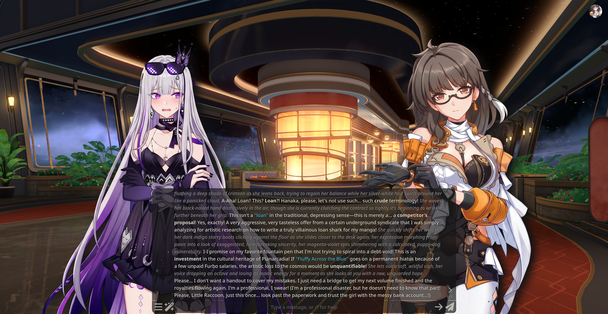
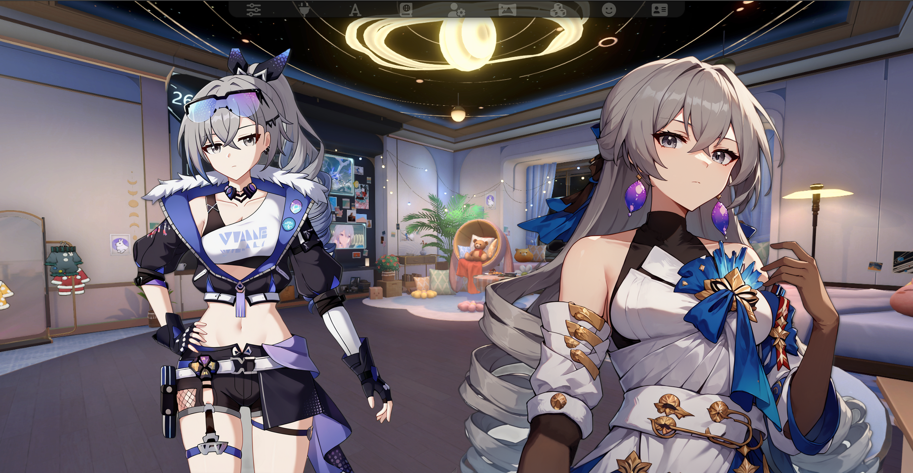
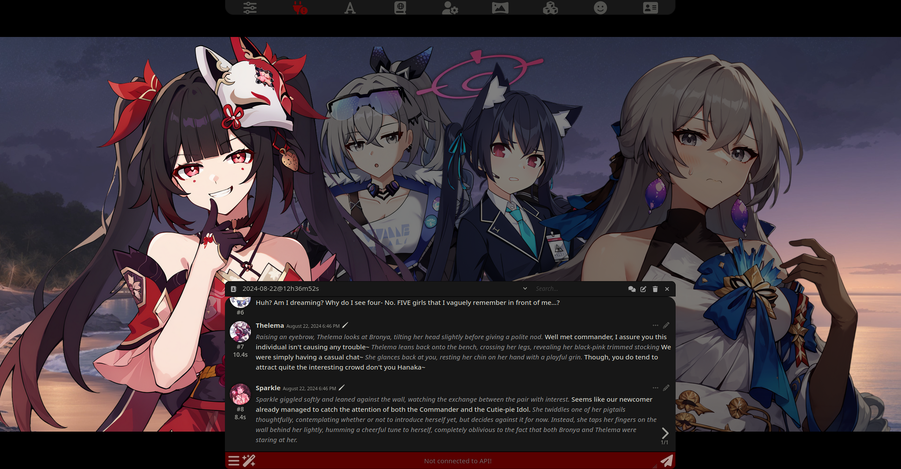

---

order: 10
tags:
[
visual novel,
vn,
]
route: /usage/user-settings/visual-novel/
---

# Visual Novel (VN) Mode

Visual Novel Mode is a special screen layout in SillyTavern that allows you to chat to characters with sprites (or their character card image) that resembles that of a visual novel like Doki Doki Literature Club, The Fruits of Grisaia, Fate: Stay/night and other famous VN games.

## Toggling Visual Novel Mode

### Enabling Visual Novel Mode

Visual Novel Mode comes built in with SillyTavern and can be toggled by going to _User Settings_ (User Settings Icon) and checking **Visual Novel Mode** below.

### Disabling Visual Novel Mode

Disabling Visual Novel Mode is the same steps as enabling it. Untoggle Visual Novel Mode and you should be back to the normal chat screen itself.

!!!danger Regarding Visual Novel Mode with VN Extensions
Extensions like the Prome VN Extension will not work with ST's Visual Novel Mode enabled and/or use a completely separate VN mode made by the developer. Refer to the extension author's instructions as to whether you need to disable ST's Visual Novel Mode or not.
!!!

## The Visual Novel UI

In Visual Novel Mode, the UI is altered slightly in order to accommodate character sprites (or the character card image) which is shown in the center. In a group chat with multiple characters however, the character sprites will spread themselves out, accommodating for each other as shown below.

### VN Mode with MovingUI

!!!info
To toggle MovingUI, go to _User Settings_ and check on **MovingUI**. Do note that this feature **only** works on Desktops.
!!!

If **MovingUI** is enabled in _User Settings_, the sprites (or character card image) can be moved around if you wish to move them around or place them in a more specific area on the screen.

!!!warning Regarding Sprite Sizes
If the size of your character sprites is relatively big it will be a challenge to try to move certain sprites around with MovingUI as the button to drag sprites around might be covered underneath an existing sprite. You will probably have to move them around a bit more than normal, especially if there is more characters on the screen for better placement.
!!!

## Obtaining Character Sprites

Obtaining character sprites can be done by browsing the internet for existing sprites, for say, an existing character from a Visual Novel or a game that uses a Visual Novel feature such as DDLC or CounterSide. If the character you desire sprites from does not come with sprites already, you have several options remaining.

1. Search the character post for any sprite ZIP package or link to a sprite pack or Google for one.
   !!!info
   Some bot creators may release their bots with a sprite pack (either within the same post or in a sprites channel). Search those posts if someone hasn't made sprites of the character you want already.
   !!!
2. Ask Gemini/ChatGPT or have a AI image gen site generate a sprite set for you.
   !!!warning
   For a six expression set this should be fine but making twenty-eight may take you a while on a free plan if you don't mind getting some generations and Photoshopping different generations together to make new expressions. It is suggested to get a paid plan for this.
   !!!
3. Create your own using Stable Diffusion and Local AI image generation.
   !!!warning
   Generating sprites from scratch is time-consuming (especially if your character is niche or has complexities) and will require decent hardware in order to generate them (depending on the image gen hardware), more so if you plan on making 28 sprite expressions than 6.
   !!!
4. Use the character card image. It might not be like a sprite, but at least you have something to look at on-screen. However, multiple character cards cannot be used in VN mode.
   !!! Character Card Images with the Prome Visual Novel Extension
   With the Prome Visual Novel Extension, there is a feature called `Emulate Character Card as Sprite` under _Sprite Emulation Settings_ that allows you to have a group chat with both sprite and non-sprite characters by using their character card as a sprite in chat.

   
   !!!

## VN Extensions

### Prome Visual Novel Extension

!!!warning Regarding Character Expressions
Prome requires you to disable the built-in [Character Expressions](../../extensions/Expression-Images.md) extension and have Visual Novel Mode [turned off](#disabling-visual-novel-mode). Forgetting to disable such may cause duplication of sprites and/or conflicting classifications between ST and Prome.
!!!

The Prome Visual Novel Extension is an endorsed third-party extension from Bronya Rand and Prometheus that enhances the visual novel experience in SillyTavern with it's own "Prome Stage" visual novel mode. Features as of Version 2.0.0 include:

- Built-in character / persona expression classifier supporting LLMs via your current LLM connection, **another LLM connection** or WebLLM or the local ST expression classifier (similar to the built-in Character Extensions extension).
- A Sprite Gallery to manage character sprites **and your own persona sprites**.
- User Sprites
- Letterbox Mode
- Traditional VN Mode
- World Tinting / Character Tinting (change the colors of the background or character in the scene)

and much much more!

|                        World Tinting                         |                         User Sprites                         |
| :----------------------------------------------------------: | :----------------------------------------------------------: |
|  |  |

|                 Hide Sheld (Message Box)                  |                      Focus Mode (w/ Darken Sprites)                      |
| :-------------------------------------------------------: | :----------------------------------------------------------------------: |
|  |  |

To install the Prome Visual Novel Extension, you can either install by going to `Download Extensions & Assets` and finding _Prome Visual Novel Extension_, or follow the installation instructions on the [Prome Visual Novel Extension](https://github.com/Bronya-Rand/Prome-VN-Extension?tab=readme-ov-file#installation-and-usage) Github page. Adjusting Prome's settings can be found either in _Extensions_ -> **Prome (Visual Novel Extension)**.
